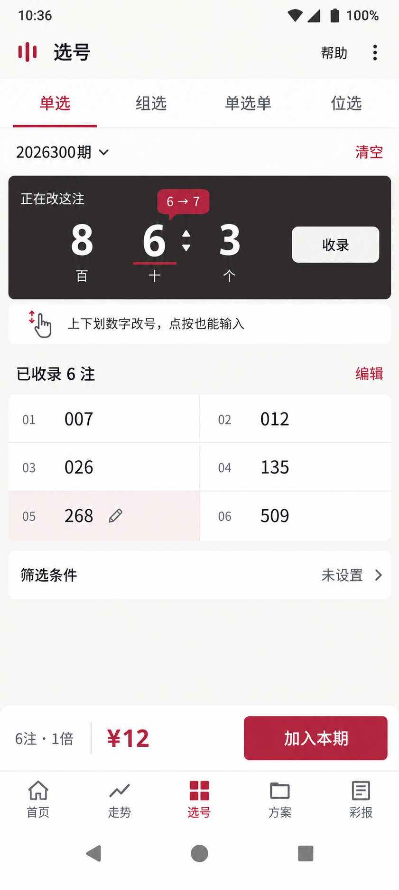
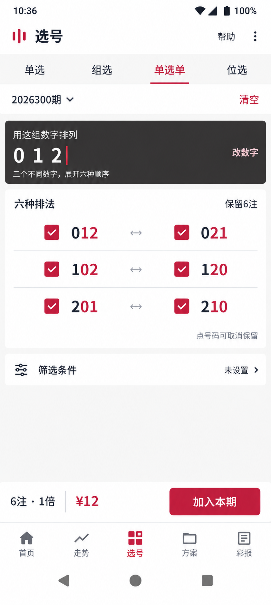
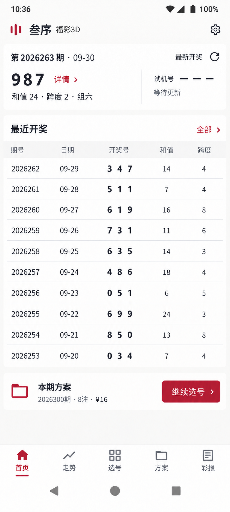
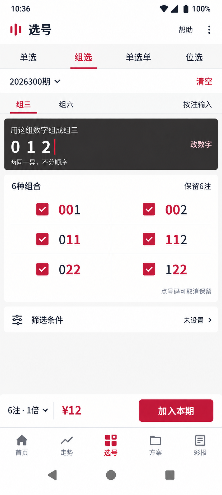
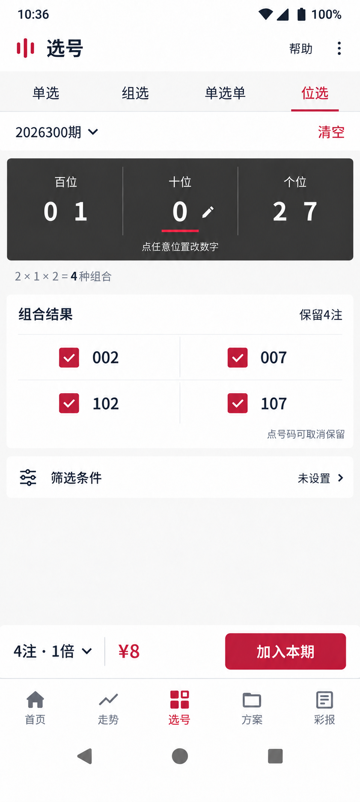

# 新 UI 设计约定 · 源码已写，待原生验证

2026-10-02。原先用户重传并选择单选与单选单两张图。本轮补齐首页、组选、位选后，用户回复“暂时差不多，实施吧”；之后要求“写好代码后就停止任务，我们下次再进行测试”。源码已按此写入，当前停止在代码交接，未编译测试、未生成新APK。

执行状态以 [tasks/todo.md](../tasks/todo.md) 和 [HANDOFF.md](../HANDOFF.md) 为准；代码文件、实现适配与待测项见 [implementation-number-studio.md](implementation-number-studio.md)。本页是设计依据，不是验收通过声明。

## 单选：直接改号

完整号码是操作对象。点按任意位调用原生输入；完整号码也能上下滑动任意位，右侧显式收录。清单中的号码可回改；更新替换原条目，改成已有号码则去重。新建号码不虚假高亮旧条目，变化气泡只表达真实变化。

保留用户重传的带6→7气泡原稿，未替换为F2。原图编辑863却高亮268的状态矛盾不进入代码。未收录文本与候选分开持久化，不提前计入金额。

## 单选单：展开排列

输入数字集合，结果按共同首位成对展示。012展开012/021、102/120、201/210，全部保留时1倍为6注12元。实际号码由PickEngine生成，超过三个数字时继续展开，不硬编码示例。结果可取消并恢复，超过六个在明细查看。

## 首页：紧凑十期

缩小开奖号，和试机号并排；“详情”明确属于正式开奖。历史表展示十期，只读行可压缩，全部开奖和详情动作保持48dp。底部一处本期方案摘要与继续选号。所有期号、号码、注数和金额来自本地真实状态。

home-v1数字过大且详情归属不清，被v2取代；旧home-dense仍仅是历史草案。

## 组选：集合与保留结果

组三/组六在当前页切换。石墨编辑区用原生输入修改数字集合；按注输入保留。组三012展示001/002、011/112、022/122，采用6项预览和checkbox，不按顺序输入三个位置。公式、规范化和组选形态仍由领域引擎决定。

## 位选：任意位置直接编辑

百、十、个位同时可见并可任意点按。输入后直接生成组合，不保留“下一位”或主页面十数字键盘。{0,1}×{0}×{2,7}生成002/007、102/107，1倍4注8元；组合公式为辅助说明，不能成为巨大视觉主体。position-v1公式过大，由v2取代。

## 全局及源码适配

暖白/暖灰、石墨编辑区、酒红动作，平面细分隔和小圆角。页标题17sp、正文13sp、辅助11sp、结果16sp、单选编辑/最新开奖号26sp；48dp触控目标，56dp底导航。方案、设置、档案、工具和回测同步减少文字与留白，走势和彩报通过公共组件继承一致密度。

源码将选号期号移到页头、清空/新建放入结果栏，节省一整行；底部倍数点击弹层调整。首页摘要没有把生成图像素机械换算为dp。以上属于原生适配，必须在下次截图比较后判断比例与空间是否合适，不能宣称严格还原已验收。

参考图中的高亮、示例数据、金额不直接驱动运行状态；只读紧凑行不冒充按钮。每页保留加载、空、错误、无网、重试和保存反馈。详尽源码设计值见 [DESIGN.md](../DESIGN.md)。

## 验证状态

当前五图是实现参考；用户尚未看到新代码运行效果。本轮按最新指示不做测试。下次用360×800dp、393×851dp的原生浅/深色截图和业务操作验证，包括前导零、回改去重、未收录恢复、剔除恢复、1000组合、手势与键盘、首屏比例和48dp。

旧1.0.2规格、截图、测试与Impeccable历史自动状态不能替代此轮证据。不重问已给出的实施授权，不恢复被否定的步骤流程。
